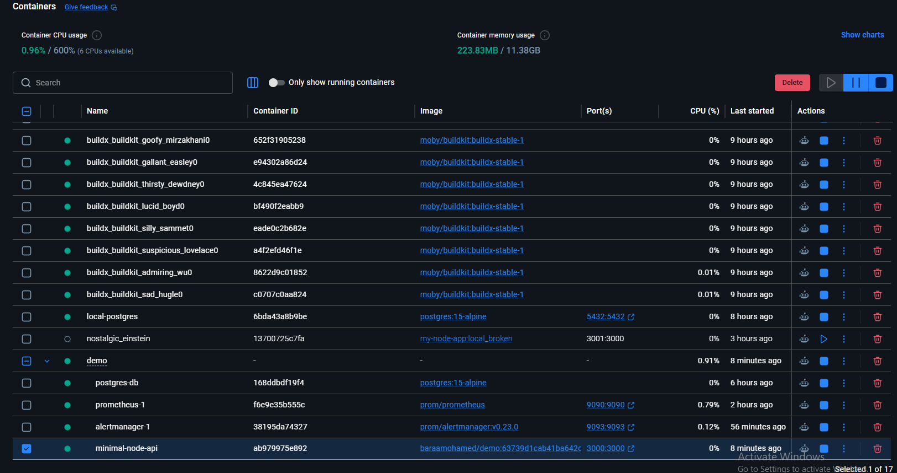
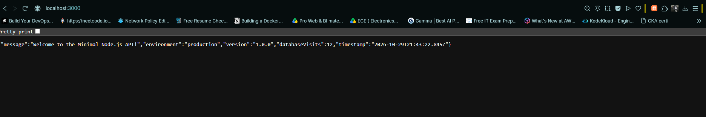
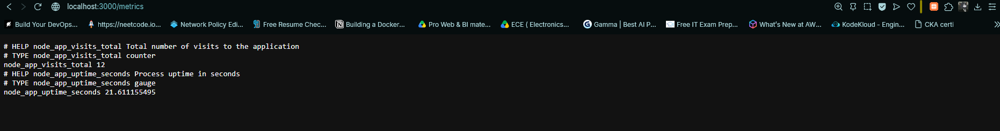
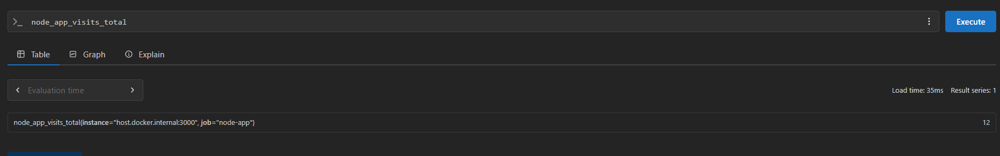
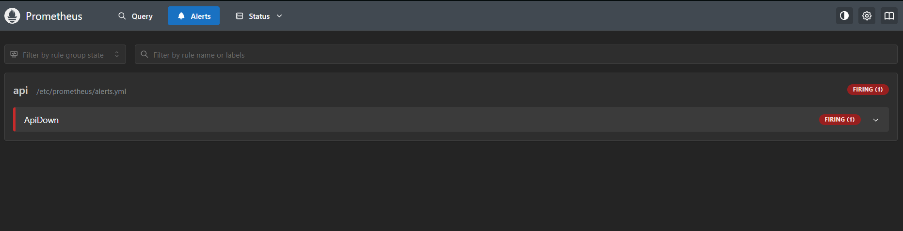
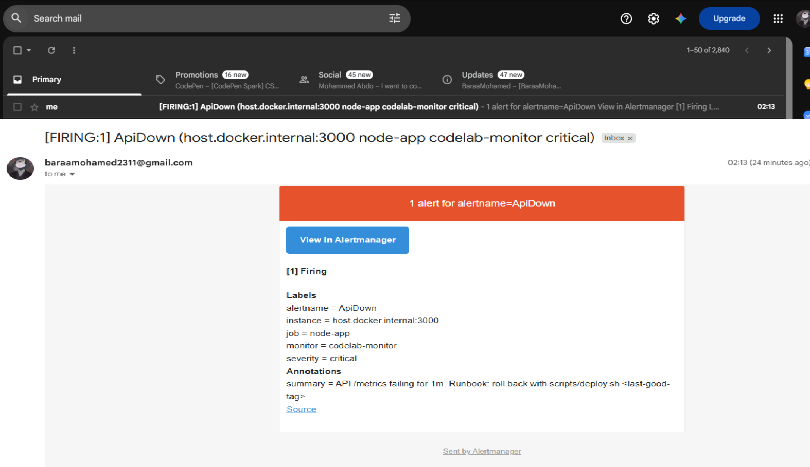
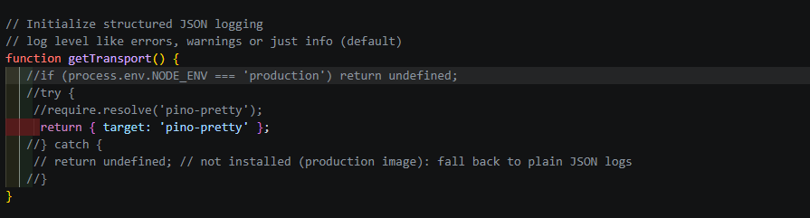
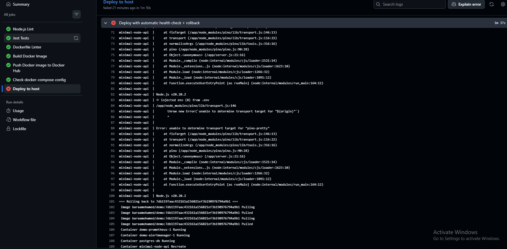
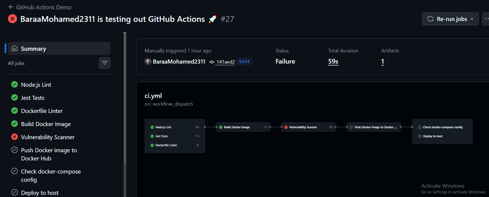

## Steps

1. Wrote the code for `server.js` and `server.test.js`.
2. Packed the small API server into Docker.
3. Connected the app and the PostgreSQL database using Docker Compose.
4. Created a `ci.yml` file with all the steps to test the app and run deployment commands.
5. Set up a self-hosted computer to run the workflow.
6. Added a rollback option using a `deploy.sh` script. This script checks if the app is healthy after deploying; if it is broken, it rolls back to the saved older version.
7. Updated `ci.yml` to use the deployment script instead of normal compose commands.
8. Set up the Prometheus monitoring service.
9. Set up the Alertmanager service to send email alerts to me.

---

## Rollback Plan

Deployment runs through a script. This script checks if the app is healthy. If the app is unhealthy, it automatically rolls back to the previously saved version.

---

## Notes

- Artifacts were used to save the built image between jobs instead of rebuilding it, which saves time and money.
- Timeouts were added to each job to stop infinite loops that cost money.
- All required secrets are added to GitHub Secrets.
- A self-hosted runner was used to save money during development and testing. It can be replaced with a real cloud server for staging or production later.

---

## AI Disclosure

AI was used to help build app servers, Jest tests, and review work (workflows, Dockerfiles, Docker Compose files, and service configurations) to make sure performance and quality are high.

The choice of approach, steps, and tools is mine. Any code created by AI was reviewed, tested, and debugged by me locally before going to production.

---

## Cost

- **GitHub Actions:** $0.006 per minute for a standard runner. A successful workflow runs for 2 minutes (without a forced vulnerability scan failure), costing about $0.36 per hour on `ubuntu-latest` (4 cores, 16GB RAM).
- **Cloud Server (Alternative):** If using a real cloud server like an AWS `m6g.xlarge` (4 cores, 16GB RAM in us-east-1), the On-Demand price is $0.1540 per hour.

---

## Evidence

### Working (Without Forced Vulnerability Scan Fail)

**Workflow GIF:**

**Running Compose:**

**Running Server:**

**Metrics Endpoint:**

**Scraped Metrics in Prometheus:**

---

### Alerting Case

*Manually stopped the app server using Docker Desktop.*

**Prometheus Alert:**

**Email Alert:**

---

### Broken Code Deployment / Rollback

*Broke the code on purpose by calling a non-production package.*

**Broken Code Snippet:**

**Rollback Due to Bad Container:**

---

### Broken Workflow (Trivy)

**Workflow Failure:**

### References
0. https://docs.github.com/en/actions/get-started/quickstart
1. https://medium.com/@vincenthartmann/how-to-add-a-security-scan-with-trivy-in-github-actions-8f16642aa82b
2- https://docs.github.com/en/actions/tutorials/publish-packages/publish-docker-images
3- https://stackoverflow.com/questions/59073731/set-default-timeout-on-github-action-pipeline
4- https://docs.docker.com/engine/daemon/prometheus/
5- https://medium.com/javarevisited/monitoring-setup-with-docker-compose-part-3-alertmanager-5d0a2d4a5612
6- https://stackoverflow.com/questions/63557145/alertmanager-not-able-send-mails-via-port-465
7- https://docs.github.com/en/actions/reference/runners/github-hosted-runners